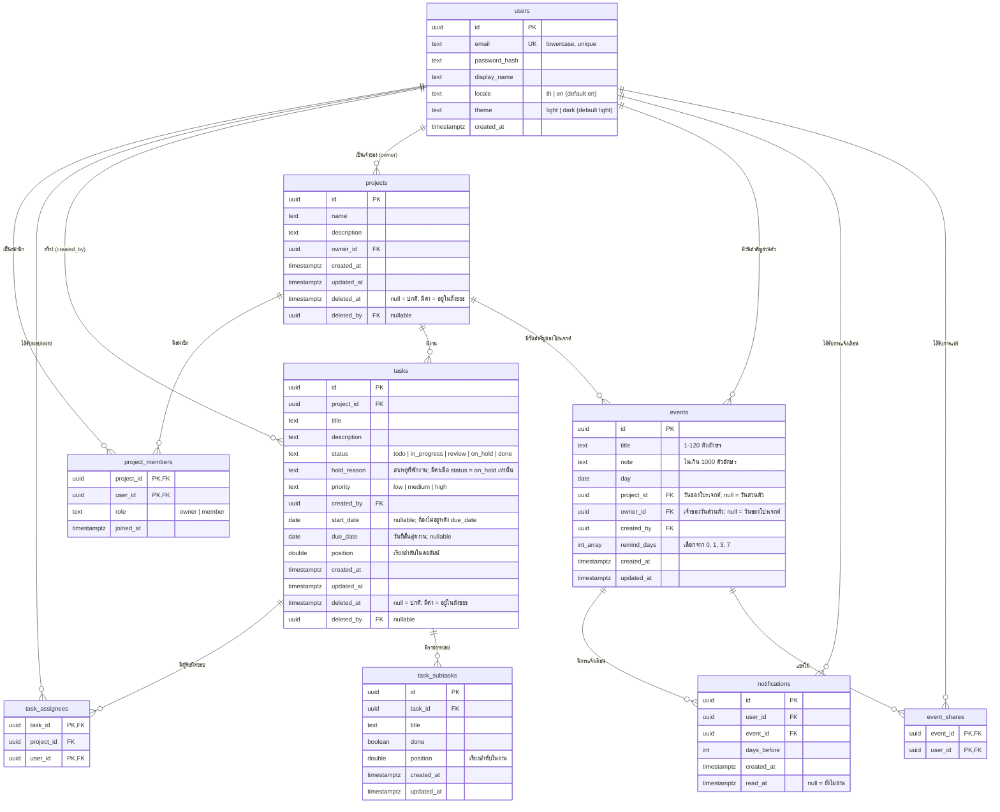

# TaskFlow: ER Diagram (ฉบับร่าง v0.2)

## กติกาของข้อมูล
- `project_members` ใช้ primary key คู่ (`project_id`, `user_id`)
- Owner ต้องมีแถวใน `project_members` ที่ `role = 'owner'` เสมอ (สร้างพร้อมโปรเจกต์ใน transaction เดียว)
- งานหนึ่งมีผู้รับผิดชอบได้หลายคนผ่าน `task_assignees` ทุกคนต้องเป็นสมาชิกของโปรเจกต์เดียวกับงาน (ตรวจใน service และบังคับด้วย composite foreign key) เอาสมาชิกออกจากโปรเจกต์แล้วแถวของเขาใน `task_assignees` จะหายไปเอง (`ON DELETE CASCADE`)
- รายการย่อยใน `task_subtasks` เป็นของงานเดียว งานละไม่เกิน 100 รายการ และลบตามงานเมื่องานถูกลบถาวร (`ON DELETE CASCADE`) ไม่มีถังขยะของตัวเอง ติ๊กครบแล้วงานไม่ย้ายคอลัมน์เอง
- `tasks.position` เป็นเลขทศนิยม: ย้ายงานไปแทรกระหว่างสองใบใช้ค่าเฉลี่ยของ position เพื่อไม่ต้องเขียนทับทั้งคอลัมน์
- ดัชนีที่ควรมี: `users(email)`, `tasks(project_id, status, position) WHERE deleted_at IS NULL` (partial index), `task_assignees(project_id, user_id)`, `project_members(user_id)`, `tasks(deleted_at) WHERE deleted_at IS NOT NULL` และ `projects(deleted_at) WHERE deleted_at IS NOT NULL` (ให้งานลบถาวรหาแถวหมดอายุได้เร็ว)
- วันสำคัญใน `events` เป็นของคนเดียว (`owner_id`) หรือของโปรเจกต์ (`project_id`) อย่างใดอย่างหนึ่งเท่านั้น (CHECK) วันของโปรเจกต์สมาชิกทุกคนเห็น เพิ่มได้ทุกคน แต่แก้หรือลบได้เฉพาะคนที่เพิ่มกับเจ้าของโปรเจกต์ ลบแล้วหายถาวรพร้อมการแจ้งเตือน (ไม่มีถังขยะ)
- วันส่วนตัวแชร์ให้คนอื่นได้ผ่าน `event_shares` (เฉพาะคนที่อยู่โปรเจกต์เดียวกับเจ้าของ ตรวจใน service) คนที่ถูกแชร์เห็นและได้รับการแจ้งเตือน แต่แก้ไม่ได้ และรายชื่อคนที่ถูกแชร์บอกเฉพาะเจ้าของ เพื่อไม่ให้อีเมลรั่วไปหาคนที่ไม่รู้จักกัน
- `notifications` มี unique key (`user_id`, `event_id`, `days_before`) งานสร้างการแจ้งเตือนจึงรันซ้ำหรือรันพร้อมกันหลายเครื่องได้โดยไม่เตือนซ้ำ เตือนเวลา 08:00 น. เวลาไทย และไม่เตือนย้อนหลังเมื่อเลยวันแล้ว เลื่อนวันแล้วการแจ้งเตือนเดิมของวันนั้นถูกลบ
- ใช้ CHECK constraint กับ `status`, `priority`, `role`, `locale`, `theme`

## ถังขยะ (soft delete 30 วัน)
- ทุก query ปกติของ `tasks` และ `projects` ต้องมีเงื่อนไข `deleted_at IS NULL` (ควรห่อไว้ใน repository จุดเดียว กันลืม)
- งานในโปรเจกต์ที่ถูกลบ ไม่ต้องตั้ง `deleted_at` ทีละใบ ซ่อนตามสถานะโปรเจกต์ (ตรวจ `projects.deleted_at` ตอน join)
- **กู้คืน:** ตั้ง `deleted_at = NULL, deleted_by = NULL` ใน transaction เดียว ผู้รับผิดชอบที่ออกจากโปรเจกต์ไปแล้วถูกลบออกจาก `task_assignees` ตั้งแต่ตอนที่เขาออก
- **ลบถาวร (purge job รายวัน):** ลบแถวที่ `deleted_at < now() - interval '30 days'` เป็นชุดเล็ก ๆ (batch) ใน transaction ลบ `tasks` ก่อน แล้ว `projects` ที่หมดอายุ (การลบโปรเจกต์ถาวรต้องลบงานและสมาชิกทั้งหมดของมันด้วย `ON DELETE CASCADE` หรือสั่งลบตามลำดับ)
- ระยะเก็บมาจาก config `TRASH_RETENTION_DAYS` (ค่าเริ่มต้น 30) ไม่ฝังตัวเลขในโค้ด
- `deleted_by` ใช้ `ON DELETE SET NULL` (MVP ยังไม่มีฟีเจอร์ลบผู้ใช้ แต่กันไว้ไม่ให้ติดข้อจำกัดภายหลัง)
